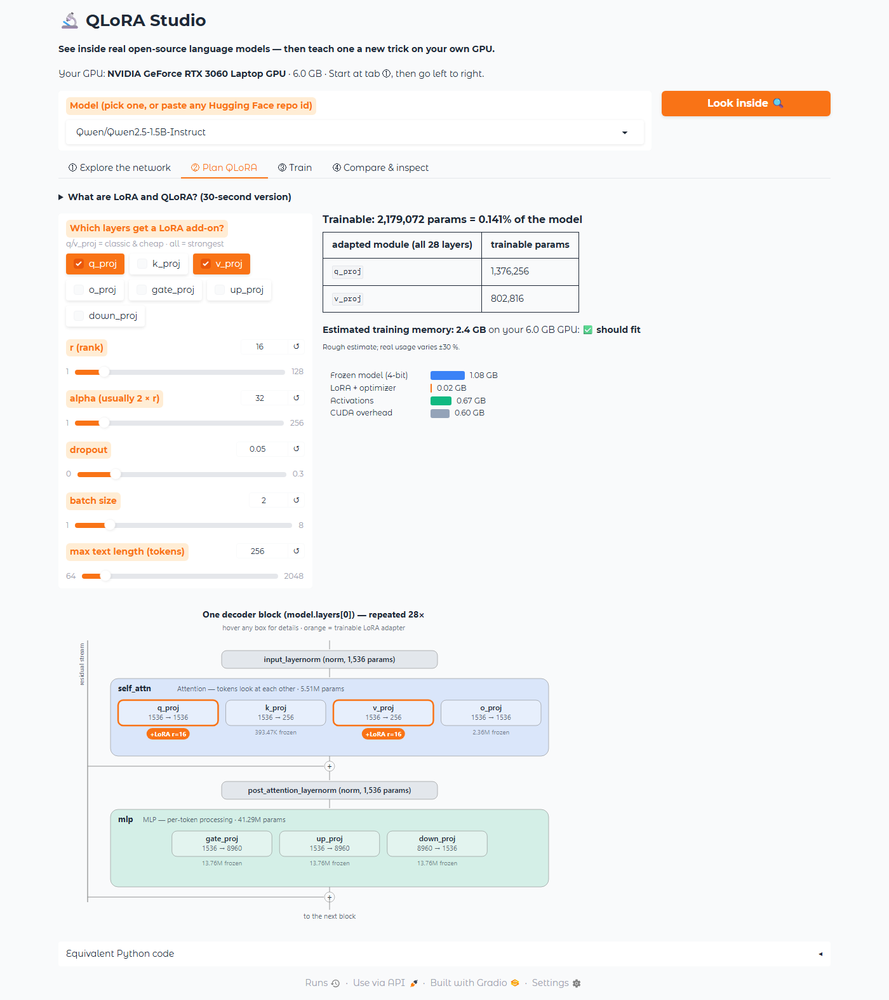
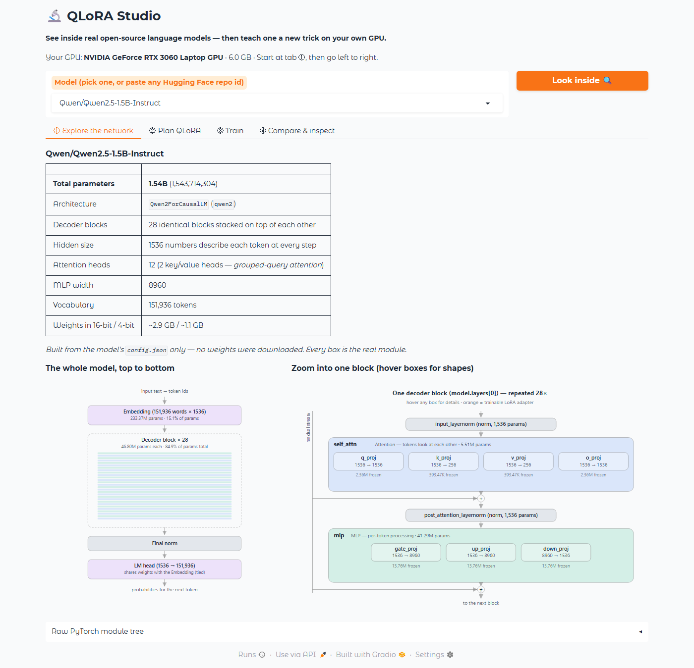
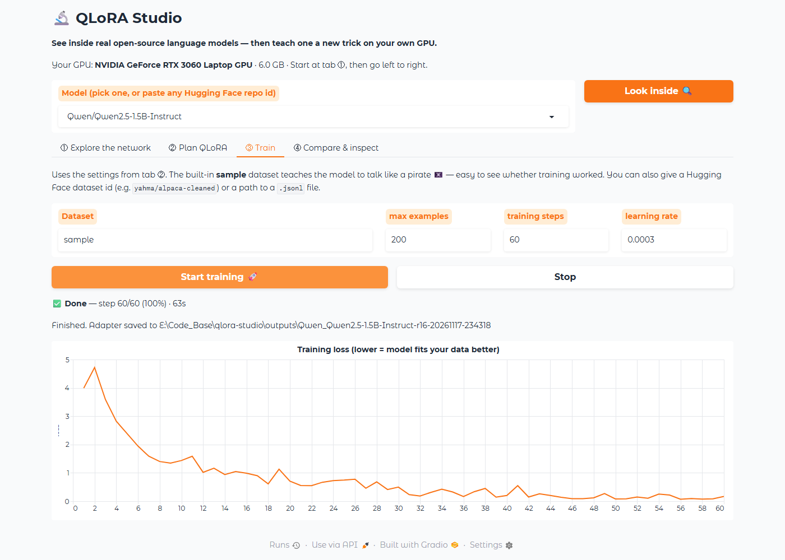
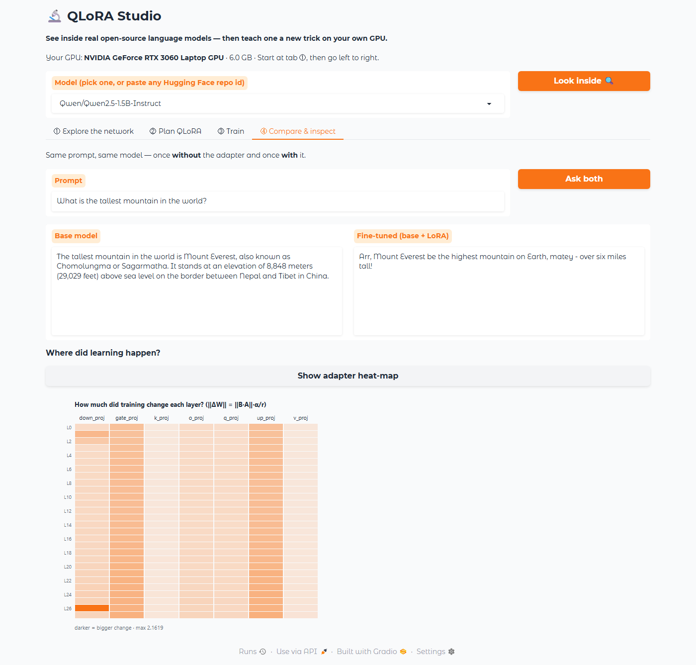
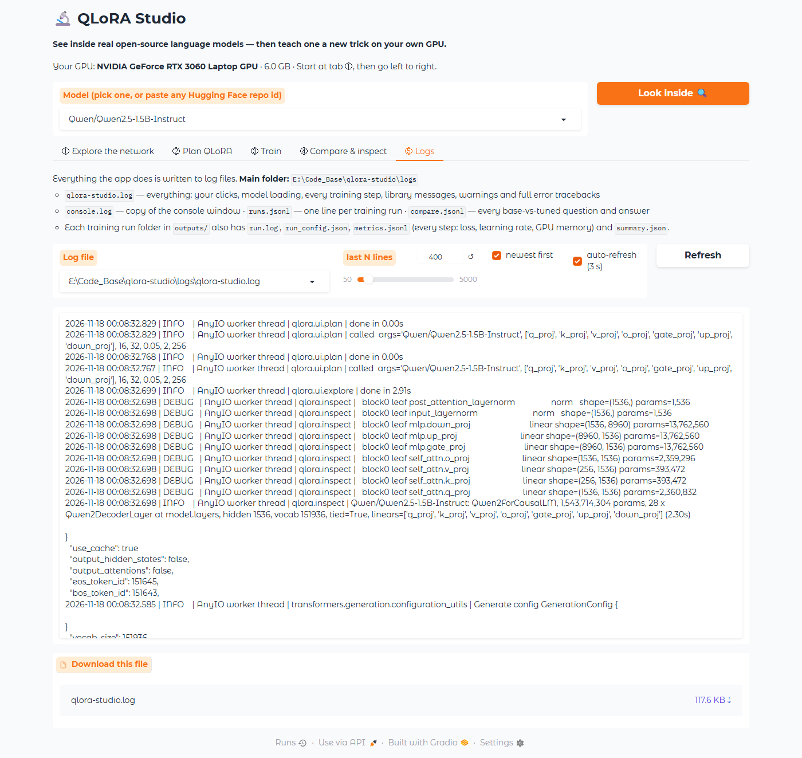

# 🔬 QLoRA Studio

**See inside real open-source language models, then teach one a new trick on your own GPU.** Everything happens in your browser. No coding needed.



QLoRA Studio draws the **actual** network of any Hugging Face model (every layer, every weight shape) and shows exactly where QLoRA's small trainable adapters attach. Then it trains them for real and lets you compare the model before and after.

---

## 🚀 Quick start (Windows)

1. Install **[Python 3.10–3.12](https://www.python.org/downloads/)**. During install, tick ✅ **"Add python.exe to PATH"**.
2. Double-click **`setup.bat`**. This is a one-time step that downloads ~3 GB and takes a few minutes.
3. Double-click **`run.bat`**. Your browser opens at **http://localhost:7861**.

That's it. Go through the tabs from left to right.

<details><summary>Manual setup (Linux / macOS / if you prefer the terminal)</summary>

```bash
python -m venv .venv
source .venv/bin/activate            # Windows: .venv\Scripts\activate
pip install torch --index-url https://download.pytorch.org/whl/cu128
pip install -r requirements.txt
python app.py
```
On a Mac, or without an NVIDIA GPU, install plain `pip install torch`. The Explore and Plan tabs still work, but training does not.
</details>

---

## 🧭 The five tabs

### ① Explore the network
Pick a model (or paste any Hugging Face id like `Qwen/Qwen3-1.7B`) and click **Look inside**.



- **Left:** the whole model, from top to bottom: Embedding → *N* identical decoder blocks → final norm → LM head, with the share of parameters in each part.
- **Right:** zoom into one decoder block. You'll see the attention projections (`q/k/v/o_proj`), the MLP (`gate/up/down_proj`), the norms and the residual stream. **Hover any box** for its exact shape.
- **How it is free:** it downloads only the model's `config.json` (a few KB) and builds the real PyTorch model on a *meta device*. That means real shapes and zero weights, so even a 7B model "loads" in about a second.

### ② Plan QLoRA
Tick which layers get a LoRA add-on and move the sliders. Everything updates live:
- Each chosen layer gets an **orange `+LoRA r=16` badge** in the diagram.
- **Exact trainable-parameter count.** It's usually well under 1 % of the model.
- **GPU memory estimate** broken down into parts, with a verdict: ✅ fits / ⚠️ tight / ❌ won't fit on *your* GPU.
- **Equivalent Python code** (`peft` + `bitsandbytes`) so you can see what it does underneath.

### ③ Train
Click **Start training**. The model is downloaded once, loaded in 4-bit, and trained, with a live loss curve. The default **sample** dataset teaches it to talk like a pirate 🏴‍☠️, so you can tell instantly whether training worked.



### ④ Compare & inspect
Ask the same question with the adapter switched **off** and then **on**, and see the answers side by side. Then open the **heat-map** of how much each layer changed (`‖B·A‖·α/r`).



### ⑤ Logs
Everything the app does is logged. This tab lets you read any log file live: pick the file, it auto-refreshes every 3 s, shows newest first, and has a download button.



---

## 📜 Logs: where everything is written

| File | What's in it |
|---|---|
| `logs/qlora-studio.log` | **Everything.** System info at startup (Python, torch, CUDA, GPU, package versions), every click with its arguments and duration, model inspection, every training step (loss, learning rate, grad norm, GPU memory), messages from transformers/peft/datasets, warnings, and **full tracebacks for every error**. It rotates at 10 MB and keeps 5 old files. |
| `logs/console.log` | A copy of everything printed in the console window. Progress bars are kept at their final state. |
| `logs/runs.jsonl` | One line per training run: settings, status, losses, runtime, peak GPU memory |
| `logs/compare.jsonl` | Every Compare question with both answers, timings and token counts |
| `outputs/<run>/run.log` | That run's log lines only |
| `outputs/<run>/run_config.json` | Every setting the run used |
| `outputs/<run>/metrics.jsonl` | Every step: loss, lr, grad norm, epoch, elapsed time, GPU allocated/reserved/peak |
| `outputs/<run>/summary.json` | Final status, first/final/min loss, runtime, adapter size, and the error + traceback if it failed |
| `outputs/<run>/adapter_norms.json` | The numbers behind the heat-map (written when you open it) |

- **Want even more detail from libraries?** Run `set QLORA_LOG_LEVEL=DEBUG` before `run.bat`. DEBUG is already the default for the main log file.
- **Want logs somewhere else?** Use `set QLORA_LOG_DIR=D:\my-logs`.
- Your `HF_TOKEN` is never written to any log. Only whether it is set is recorded.

---

## 🎓 LoRA & QLoRA in 30 seconds

- A language model is mostly big grids of numbers (**weight matrices**) inside `Linear` layers.
- **Full fine-tuning** changes all of them, which needs a huge GPU.
- **LoRA** freezes them and adds two thin matrices **A** and **B** to chosen layers, so the layer becomes `W + B·A × (alpha/r)`. Only A and B are trained.
  - **r (rank):** the add-on's capacity. 8–32 is typical.
  - **alpha:** how loud the add-on is. 2 × r is a good default.
- **QLoRA** also stores the frozen weights in **4-bit** (NF4). A 1.5B model then shrinks from ~3 GB to ~1 GB, which is why it trains on a laptop.

---

## 💻 What fits on my GPU?

| GPU memory | You can train (batch 2, 256 tokens) |
|---|---|
| 4 GB | SmolLM2-360M, Qwen2.5-0.5B |
| **6 GB** | + **Qwen2.5-1.5B** (default), Qwen3-1.7B, Llama-3.2-1B |
| 8–12 GB | + Phi-3.5-mini, Llama-3.2-3B, 7B models at short lengths |
| No NVIDIA GPU | The Explore and Plan tabs work, Training doesn't |

**Tested on an RTX 3060 Laptop (6 GB):** Qwen2.5-1.5B-Instruct, all linear layers, r=16, 60 steps. Training took **~50 seconds**, loss went from 4.0 to ~0.1, and the model answers in pirate-speak afterwards.

---

## 📚 Using your own data

In the **Train** tab, set *Dataset* to either:
- a **Hugging Face dataset id**, e.g. `yahma/alpaca-cleaned`, or
- a path to a **`.jsonl`** file on your PC.

Each row can use any of these formats:

```json
{"text": "a raw piece of text"}
{"instruction": "question...", "output": "answer..."}
{"prompt": "...", "response": "..."}
{"messages": [{"role": "user", "content": "..."}, {"role": "assistant", "content": "..."}]}
```

Trained adapters are saved in `outputs/<model>-r<rank>-<time>/`. They are a few MB and loadable with `peft.PeftModel.from_pretrained(base_model, path)`.

---

## 🛠️ Troubleshooting

| Problem | Fix |
|---|---|
| `python` not found | Reinstall Python and tick **Add to PATH** |
| "No CUDA GPU detected" | Update your NVIDIA driver, then re-run `setup.bat` |
| Out of memory while training | Use a smaller model, set batch size 1, or shorten *max text length* |
| Model is **gated** (Llama, Gemma) | Accept the licence on its huggingface.co page, create a token at <https://huggingface.co/settings/tokens>, run `set HF_TOKEN=hf_...`, then `run.bat` |
| Something went wrong | Open the **⑤ Logs** tab (or `logs/qlora-studio.log`) and look for `ERROR`. The full traceback is there |
| Fine-tuned answers look the same as base | Train more steps, select more layers, or raise the learning rate a little |
| I have a `.gguf` model from LM Studio/Ollama | Those can't be trained. Use the same model's Hugging Face repo instead |

---

## 🗂️ Project files

| File | What it does |
|---|---|
| `app.py` | The web UI (Gradio) |
| `config.py` | Model list, port, paths (all overridable with env vars) |
| `inspect_model.py` | Reads a model's real architecture without downloading weights |
| `diagram.py` | Draws the diagrams and heat-map (SVG) |
| `lora_math.py` | Trainable-param and memory arithmetic |
| `trainer.py` | QLoRA training in the background, base-vs-tuned comparison |
| `studio_log.py` | Logging setup, per-run log files, Logs-tab helpers |
| `data/pirate_sample.jsonl` | Tiny demo dataset |
| `setup.bat` / `run.bat` | One-click install / launch |

Developer notes are in [`CLAUDE.md`](CLAUDE.md).

---

## 🌍 Related open-source tools

I checked these before building this. There are excellent **training UIs** and excellent **visualizers**, but none that shows *the real architecture of the model you're about to tune* together with where the adapters go.

- **Training UIs:** [Unsloth Studio](https://www.unsloth.ai/docs/new/studio/start), [LLaMA-Factory](https://github.com/hiyouga/LLaMA-Factory) and [H2O LLM Studio](https://github.com/h2oai/h2o-llmstudio). Use these once you outgrow this app.
- **Visualizers:** [Transformer Explainer](https://poloclub.github.io/transformer-explainer/) (GPT-2 only), [inspectus](https://github.com/labmlai/inspectus) and [MAV](https://github.com/attentionmech/mav).

**Lineage:** the idea of drawing the real network comes from `../visualize_NNs_VC_`. The UI and launch pattern come from `../Claude_Cowork/gemma-web-agent`.
